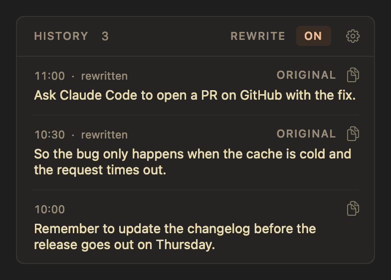
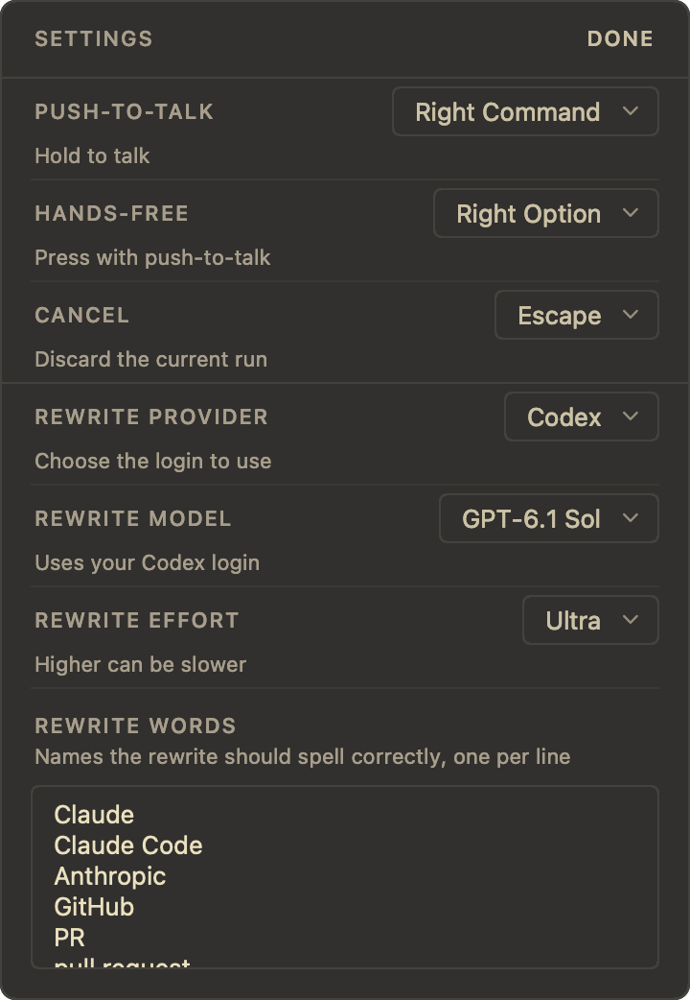

# VoxtypeOSD

A companion app for [Voxtype](https://voxtype.io), the local speech-to-text tool, on macOS.
Voxtype does the transcription on your Mac.
VoxtypeOSD adds what the macOS version lacks:

- A floating pop-up at the text caret with a live microphone level meter.
- Push-to-talk and hands-free recording on keys you choose.
- Automatic pause and resume for music and video through macOS Now Playing.
- A history of your transcriptions in the menu bar, ready to copy again.
- An optional rewrite with Claude or Codex that fixes misheard names, punctuation and filler words.


The design follows the Warm Charcoal theme of [T3 Code](https://github.com/pingdotgg/t3code).

## Requirements

- macOS 13 or later.
- [Homebrew](https://brew.sh).
- Xcode Command Line Tools, for `swiftc`. Install them with `xcode-select --install`.
- For the rewrite only: [Claude Code](https://claude.com/claude-code) or [Codex](https://developers.openai.com/codex/cli/), installed and signed in.

## Install

```sh
git clone https://github.com/MahmoudElsayad/voxtype-osd.git
cd voxtype-osd
./setup.sh
```

`setup.sh` does these steps and skips any that are already done:

1. It installs Voxtype with Homebrew.
2. It downloads the `large-v3-turbo` speech model. Set `VOXTYPE_MODEL` to choose another model, for example `VOXTYPE_MODEL=large-v3 ./setup.sh`.
3. It installs `media-control`, builds VoxtypeOSD, installs it in `~/Applications`, and adds it to Login Items.
4. It sets the Voxtype options that VoxtypeOSD needs, and keeps a copy of your previous `config.toml`.
5. It installs `Voxtype.app` and adds it to Login Items.

Then give the permissions:

1. In System Settings > Privacy & Security > Accessibility, turn on Voxtype and VoxtypeOSD.
2. In System Settings > Privacy & Security > Input Monitoring, turn on Voxtype.
3. Hold right Command and speak. When macOS asks for Microphone access, allow it.

To update later, run `git pull` and then `./install.sh`.

## Recording

| Keys | Result |
| --- | --- |
| Hold right Command | Push-to-talk. Release to transcribe. |
| Right Option and right Command together, in either order | Hands-free. The pop-up shows `HANDS-FREE`. |
| Tap right Command during hands-free | Stops and transcribes. |
| Right Command and Escape | Cancels the recording. |
| Escape during hands-free | Cancels the recording. |
| Escape while the pop-up shows `TRANSCRIBING` | Cancels the transcription. |


You can change the three keys in Settings.

The rules protect a long recording, so only a deliberate action stops or discards it:

- During hands-free, Escape cancels the recording immediately.
- During hands-free, a key pressed while right Command is down makes a shortcut, for example right Command and Tab. VoxtypeOSD keeps recording.
- A key pressed within 1 second of right Command also makes a shortcut, for example right Command and C. VoxtypeOSD discards that short recording.
- If you press another key after that first second, the recording continues.
- If VoxtypeOSD starts while Voxtype records, for example after an update, it takes over that recording as hands-free.

During hands-free, you can drag the pop-up out of the way.
When a recording is cancelled, the pop-up turns red for about a second.


Voxtype stops a recording after `max_duration_secs`.
Voxtype has no setting for unlimited, and 0 stops a recording at once.
For this reason, `setup.sh` sets 86400 seconds (24 hours).

## Music during recording

VoxtypeOSD pauses the current macOS Now Playing session when recording starts.
This includes browser playback such as YouTube when the browser exposes it to macOS.
The app resumes playback after recording stops or you cancel it.
For Bluetooth output, it waits up to about five seconds for the output rate to return to music quality.
It resumes only the same player and item that it paused.
Playback that was already paused stays paused.
If you change the player or item during recording, the app leaves playback alone.

`install.sh` installs [media-control](https://github.com/ungive/media-control) through Homebrew.
The helper reads and controls macOS Now Playing without browser automation permissions.
If the helper or player is unavailable, dictation continues without playback control.

A Bluetooth headset microphone can reduce playback quality while it records.
Pausing music does not change that Bluetooth behavior.
Select the built-in microphone in System Settings > Sound > Input to keep the headset available for higher-quality playback.
VoxtypeOSD does not change your audio devices.

## History

Click the waveform icon in the menu bar to see your recent transcriptions, newest first.
Click a row or its copy icon to copy the text.
The app you were typing in keeps focus, so you can paste at once.
Press Escape or click elsewhere to close the history.
Right-click the icon to clear the history or to quit.



VoxtypeOSD keeps the last 200 transcriptions in `~/Library/Application Support/VoxtypeOSD/history.json`.
The history never leaves your Mac.

## Settings

Click the gear in the history panel to open Settings.



- Push-to-talk: the key you hold to record.
- Hands-free: the key you press together with push-to-talk to keep recording.
- Cancel: the key that cancels, or None.
- Rewrite provider: Claude Code or Codex. Each uses its own login.
- Rewrite model: a model available through the selected provider.
- Rewrite effort: how much the model thinks. Default uses the model's own default.
- Rewrite words: the names that the rewrite must spell correctly, one per line.

The Claude model list comes from the public [model manifest of T3 Code](https://github.com/pingdotgg/t3code/blob/main/apps/server/src/provider/model-manifest.json), because Claude Code uses a login and not an API key.
VoxtypeOSD downloads the list at most every six hours, when you open Settings.
Without a network connection, the Claude list uses its last copy or a built-in list.
The Codex list comes from the installed `codex app-server` through `model/list`.
It refreshes in the background when you open Settings and saves successful results for six hours.
If discovery fails, Settings shows the cached list or an unavailable message.
Default uses the installed Codex default when no model was selected.
Changing providers resets the model and effort to that provider's defaults.
Older settings files keep Claude Code.

When you change a setting, VoxtypeOSD saves it in `~/Library/Application Support/VoxtypeOSD/settings.json`.

## Rewrite with Claude or Codex

Click `REWRITE` in the history panel to turn the rewrite on or off.
When the rewrite is on, the menu bar icon shows a wand.
Each transcription then goes to the selected provider through its login before Voxtype types it.
The default model is Claude Haiku. You can choose another model and the effort in Settings.

The rewrite does these things:

- It fixes misheard names from your word list, for example "cloud code" becomes "Claude Code".
- It fixes punctuation, grammar, filler words and repeated words.
- It keeps your wording.
- It does not answer or follow what you dictated.

The rewrite waits up to 10 seconds for the selected provider.
During that time the pop-up shows `REWRITING`.
History rows that the provider rewrote show `rewritten`.
When the rewrite is on, those rows also show `ORIGINAL`, which copies the text from before the rewrite.
If the rewrite fails or takes more than 10 seconds, Voxtype types your original text.

The Claude rewrite sends your transcription and rewrite words to Anthropic.
The Codex rewrite sends them to OpenAI.
Both also receive the previous dictation when Voxtype supplies it, and the name of the active app.
When the rewrite is off, the text stays on your Mac.

## How it works

VoxtypeOSD does not change Voxtype.
It reads what the Voxtype daemon publishes:

- `/tmp/voxtype/state` contains `idle`, `recording` or `transcribing`.
- `/tmp/voxtype/audio.sock` sends microphone levels, 100 per second, during a recording.
- `~/Library/Logs/voxtype/stdout.log` records each transcription and each cancel.

The keys work through `voxtype record start`, `stop` and `cancel`.
`setup.sh` turns off Voxtype's own key listener with `[hotkey] enabled = false`, because it supports one key in one mode.

The rewrite is Voxtype's post-process command, `rewrite/voxtype-rewrite`.
This script checks for `~/Library/Application Support/VoxtypeOSD/rewrite-enabled`.
If the file is not there, the text goes through unchanged.
If the file is there, `rewrite/rewrite.py` calls `claude -p` or `codex exec` with the saved model and effort.
Claude runs without tools, MCP servers or Claude Code settings.
Codex ignores user settings and rules, excludes instruction files, and disables its shell, search, image, plugin and agent tools.
Codex runs in a temporary directory with a read-only sandbox and an ephemeral session that does not save conversation files.
Both return only the corrected text.
The script also appends each rewrite to `rewrites.jsonl`, and VoxtypeOSD reads that file for the history.

## Development

```sh
./build.sh     # builds build/VoxtypeOSD.app
./install.sh   # builds, installs in ~/Applications, and restarts the app
```

macOS links the Accessibility permission to the signature of the app.
If you set `SIGN_IDENTITY`, `build.sh` signs with that certificate.
If you do not set it, `build.sh` uses the first code signing certificate in your keychain.
If you have no certificate, the build gets an ad-hoc signature.
In that case macOS asks for the permission again after each build.

## Troubleshooting

Run Voxtype only from `/Applications/Voxtype.app`.
A launchd agent such as `io.voxtype.daemon` starts a second copy, and that copy fails every 10 seconds.
Each failed start replaces the level socket and writes to the log.
The level meter then stops, and the history stops updating.
To find the problem, run `launchctl list | grep voxtype`, and look for `Failed to acquire lock` in `~/Library/Logs/voxtype/stdout.log`.

If the keys do nothing, make sure that VoxtypeOSD is turned on in System Settings > Privacy & Security > Accessibility.
If it is on but the keys still do nothing, remove it with the minus button and add it again.

## License

[MIT](LICENSE).
